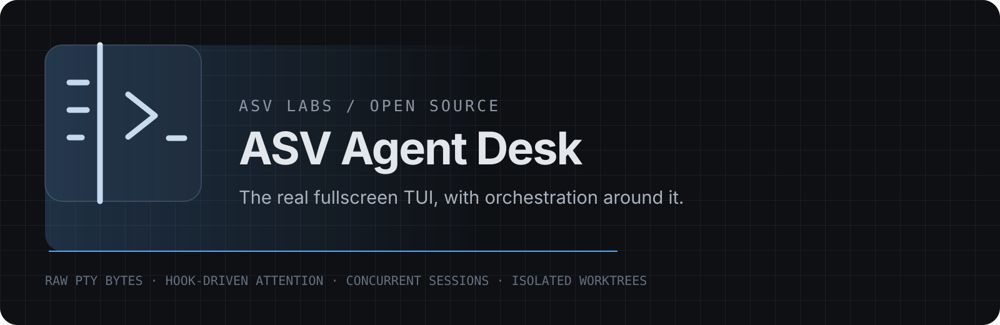
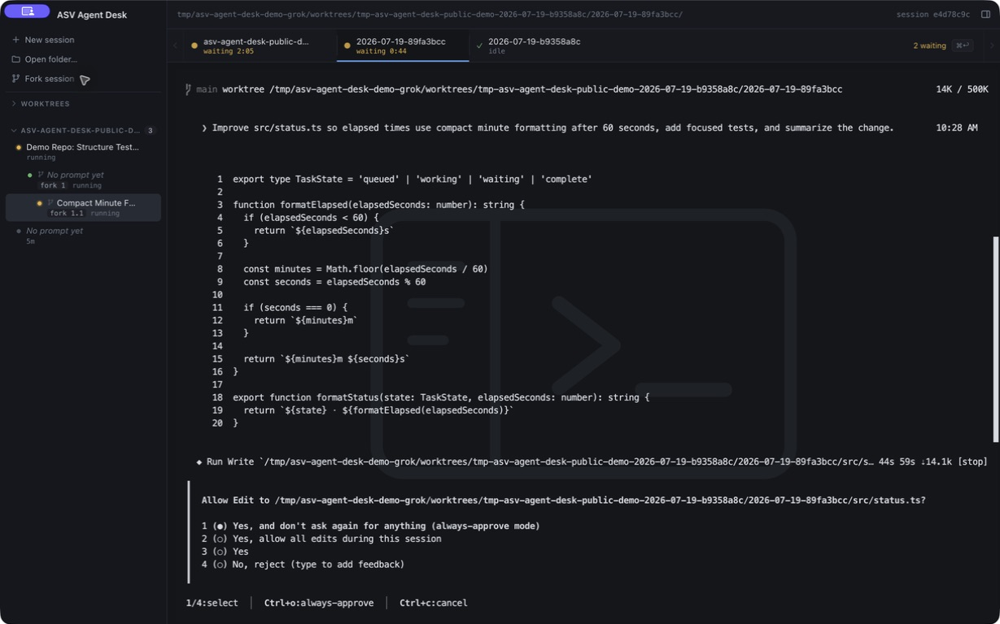
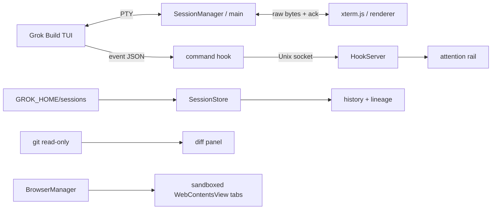

<p align="center">
  
</p>

<p align="center">
  <a href="https://asv-labs.github.io/asv-agent-desk/"></a>
  <a href="https://github.com/ASV-Labs/asv-agent-desk/actions/workflows/ci.yml"></a>
  
  <a href="LICENSE"></a>
  
</p>

# ASV Agent Desk

Run the real Grok Build fullscreen TUI. Orchestrate the work around it.

ASV Agent Desk is a local-first Electron workspace for concurrent coding-agent sessions. It
does not replace the terminal experience or scrape it into a fake chat UI. Grok Build runs live
inside xterm.js while hooks, session files, worktrees, and git provide the surrounding attention
rail, history, lineage, diffs, and browser.

> **Source available now. A signed and notarized macOS build is pending Apple Developer Program
> enrollment.**

There is no official DMG yet. Do not trust binaries distributed elsewhere under this project
name.

ASV Agent Desk is an independent ASV Labs project. It is not affiliated with, sponsored by, or
endorsed by X.AI LLC. Grok, Grok Build, xAI, and their marks are owned by X.AI LLC. The official
CLI is a separate prerequisite and is not bundled or redistributed here.

## See it



The screenshot is captured from the sanitized public build against a disposable demo
repository.

## Source setup

### 1. Install the official Grok Build CLI

```bash
curl -fsSL https://x.ai/cli/install.sh | bash
```

Review the current instructions in the
[official Grok Build documentation](https://docs.x.ai/build/overview).

### 2. Clone and install

```bash
git clone https://github.com/ASV-Labs/asv-agent-desk.git
cd asv-agent-desk
npm ci
```

### 3. Launch

```bash
npm run dev
```

Choose **Continue with OAuth** on first run. ASV Agent Desk launches `grok --oauth`; Grok Build
owns the official browser flow and credential storage. ASV Agent Desk never reads or stores the
token.

Already authenticated? The same action starts the normal TUI using the existing Grok
credentials.

## 01 — Real fullscreen TUI, raw bytes

The actual alternate-screen TUI stays intact: plan viewer, mouse reporting, subagents, streaming
redraws, and keyboard behavior. Bytes move unparsed in both directions. A byte-acknowledgement
loop applies backpressure when xterm falls behind.

## 02 — Hook-driven attention

The rail shows `working`, `needs-you`, `failed`, and `exited` states, time-in-state, current tool,
and live subagent count. A turn ending means the agent needs attention—not that the work is
silently "done." `⌘↩` jumps to the session that has waited longest.

State comes from personal Grok hooks over a local Unix socket. It never comes from terminal
text.

## 03 — Concurrent sessions and isolated forks

Every active session owns a PTY in main and stays alive while unfocused. `⌘⇧F` forks the active
session into a Grok-managed git worktree. Parent, fork, and fork-of-fork run simultaneously
against independent checkouts and remain nested after relaunch.

The main process refuses to remove any worktree with a live session or uncommitted changes.

## 04 — Real diffs and sandboxed browser tabs

The right panel reads working-tree diffs through git without staging or mutating files. Browser
tabs are native sandboxed `WebContentsView` instances with separate storage, context isolation,
disabled Node integration, and main-owned lifecycle.

## 05 — Local-first history and cleanup

The sidebar reads Grok's real session summaries from disk, groups them by project and lineage,
and resumes stored sessions by ID. `GROK_HOME` is honored consistently across history,
worktrees, hooks, and watchers.

ASV Agent Desk never writes to Grok's session history.

## Architecture



Read [the architecture document](docs/ARCHITECTURE.md) for ownership, security boundaries,
shutdown behavior, hook transport, and worktree safety.

## Privacy and filesystem access

The app is local-first, but it is not a filesystem sandbox for the coding agent. Grok Build runs
with the permissions and environment of the user who launched ASV Agent Desk.

ASV Agent Desk itself:

- reads Grok session summaries and worktrees under `GROK_HOME` or `~/.grok`;
- reads git status and diffs for the active project;
- writes its own lineage file under the Electron app-data directory;
- temporarily writes `asv-agent-desk.json` and `asv-agent-desk-emit.sh` under the personal
  Grok hooks directory;
- creates a short-lived Unix socket and removes it on clean quit;
- never reads terminal output for state and never writes Grok session history;
- never stores OAuth tokens or API keys.

## Authentication

### OAuth — recommended

Use the first-run **Continue with OAuth** action. The official CLI opens the browser and remains
the authority for authentication, logout, and token storage.

### API key — advanced source builds

Grok Build also accepts `XAI_API_KEY` in the launching environment:

```bash
export XAI_API_KEY="xai-your-key"
npm run dev
```

The app does not load `.env` files, show a key field, or persist this value. Prefer OAuth unless
you have a source-build workflow that requires an API key.

## Troubleshooting

**The app says Grok Build is missing.** Run the install command, restart your shell, then choose
**Recheck**. Finder-launched builds resolve `grok` through your login-shell `PATH`.

**A newer version is labeled unverified.** This release was verified with `0.2.103`. Newer
versions are not blocked, but hooks and undocumented session-summary fields can change.

**The rail does not update.** Run `grok inspect` in the project and confirm the personal
`asv-agent-desk` command hook is loaded. Do not add a project hook; untrusted projects suppress
those.

**History is empty with a custom profile.** Confirm the app and CLI share the same `GROK_HOME`.

**A package builds but no session starts.** `node-pty` requires both `pty.node` and executable
`spawn-helper` outside the asar. A production bundle is not equivalent to a runtime smoke test.

## Development and packaging

```bash
npm test
npm run typecheck
npm run build
npm run website:build
npm run verify:public
npm run audit:media
```

`npm run dist` creates a local arm64 DMG. It is not an authorized public release. Signing,
notarization, Gatekeeper, and quarantined-install verification remain mandatory before any DMG
is published.

See [Development](docs/DEVELOPMENT.md), [Releasing](docs/RELEASING.md), and
[Contributing](CONTRIBUTING.md).

## Compatibility

| Dependency | Verified | Notes |
| --- | --- | --- |
| macOS | Apple Silicon | Source and package smoke tests |
| Grok Build | `0.2.103` | TUI, hooks, sessions, subagents, worktrees |
| Electron | `43.1.1` | Native view and shutdown verification |
| Node.js | `22.22.3` | Development and CI baseline |

## Roadmap

- [x] Real PTY and fullscreen TUI
- [x] Concurrent hook-driven sessions
- [x] Session history and resume
- [x] Worktree forks and lineage
- [x] Diffs and native browser tabs
- [x] OAuth-first source onboarding
- [ ] Developer ID signing, notarization, stapling, and Gatekeeper-tested DMG

## License

[MIT](LICENSE) © 2026 ASV Labs
