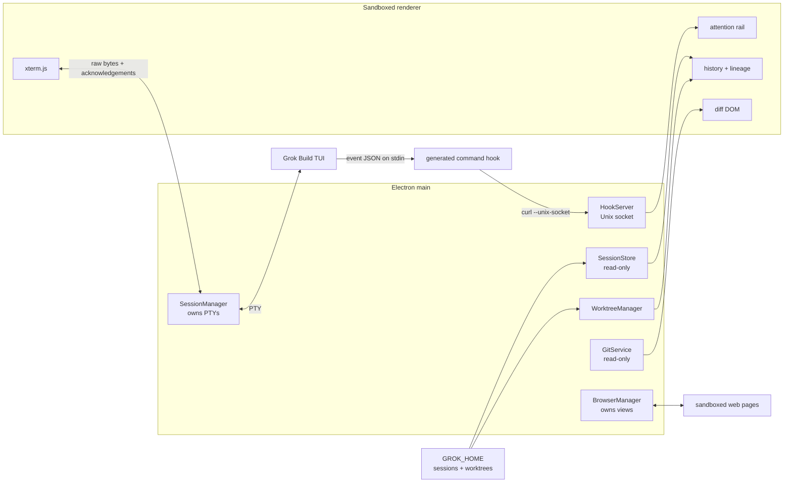

# Architecture

ASV Agent Desk is a terminal core with desktop orchestration around it. The center is not a
reimplementation: it is the real Grok Build fullscreen TUI running inside `node-pty` and
xterm.js.



## Process ownership

Main owns every process and native view:

- `SessionManager` owns all PTYs and keeps every active session mounted.
- `BrowserManager` owns browser tab identity, order, selection, and `WebContentsView` lifetime.
- The renderer mirrors serializable state and may attach or detach views without killing work.
- A renderer reload reconnects to main-owned sessions and replays a bounded output buffer.

This prevents React lifecycle events from becoming process lifecycle events.

## Terminal boundary

The PTY path is deliberately boring:

```text
pty.onData -> IPC -> term.write -> byte acknowledgement
term.onData -> IPC -> pty.write
```

No layer parses terminal output. Grok's alternate screen, mouse reporting, plan viewer, and
subagent UI remain authoritative. Backpressure pauses a PTY above 512 KiB unacknowledged and
resumes below 128 KiB. Inactive sessions keep running and buffer recent output.

The terminal column has fixed-height chrome. Width changes are debounced into `SIGWINCH`;
runtime height changes are prohibited because they corrupt a fullscreen TUI mid-render.

## Hook transport

Grok Build rejects loopback `http://` hooks under its SSRF policy. ASV Agent Desk therefore:

1. listens on a bounded Unix-domain socket;
2. writes a personal command-hook config and generated executable emitter under the resolved
   Grok home;
3. forwards stdin JSON with `curl --unix-socket --max-time 2`;
4. discards hook output and always exits zero;
5. removes the two files and socket on clean quit.

`PreToolUse` is intentionally absent because it is the only blocking event.

## Data ownership

ASV Agent Desk reads:

- `GROK_HOME/sessions` for history and summaries;
- `GROK_HOME/worktrees` plus read-only git commands for checkout state;
- Grok hook events for live activity;
- git diffs for the right panel.

It writes only its own fork-lineage file under Electron's app data directory and its ephemeral
personal hook bridge. It never writes Grok session history, stages files, commits, checks out
branches, or directly deletes worktree directories.

## Worktrees and lineage

Forking launches a typed Grok session with `-w` and records a parent edge. Grok chooses the
checkout path. The first hook event reports the real worktree `cwd`; only worktree sessions may
adopt it. Diffs, further forks, and removal guards use the corrected path.

Removal delegates to `grok worktree rm` and is refused in main when a live session or
uncommitted change exists.

## Browser isolation

Browser tabs use `WebContentsView`, `sandbox: true`, context isolation, disabled Node
integration, `webSecurity: true`, and a dedicated persistent partition. Inactive views are
detached from the window so they are absent from the accessibility tree while their page state
survives.

## Runtime and authentication

Main resolves the CLI from the user's login-shell `PATH`, reads `grok version`, and exposes only
a typed status—not the executable path—to the renderer. Command and arguments are passed
positionally through a fixed login-shell program. OAuth is delegated to `grok --oauth`; the app
does not read or store credentials.

